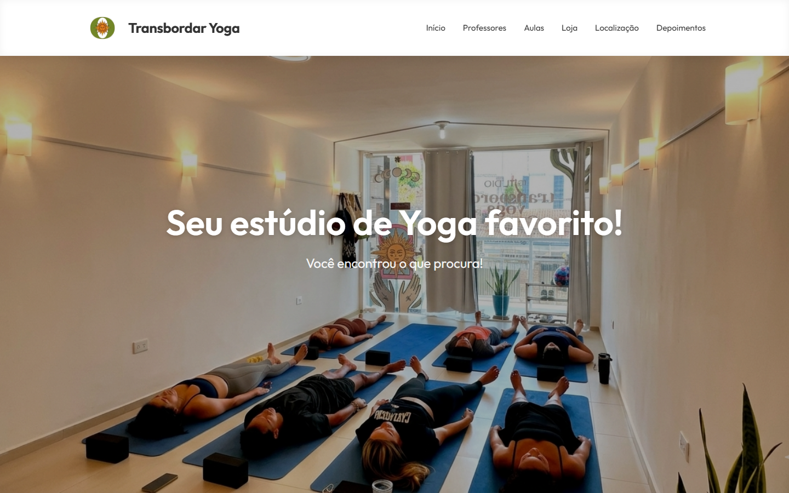
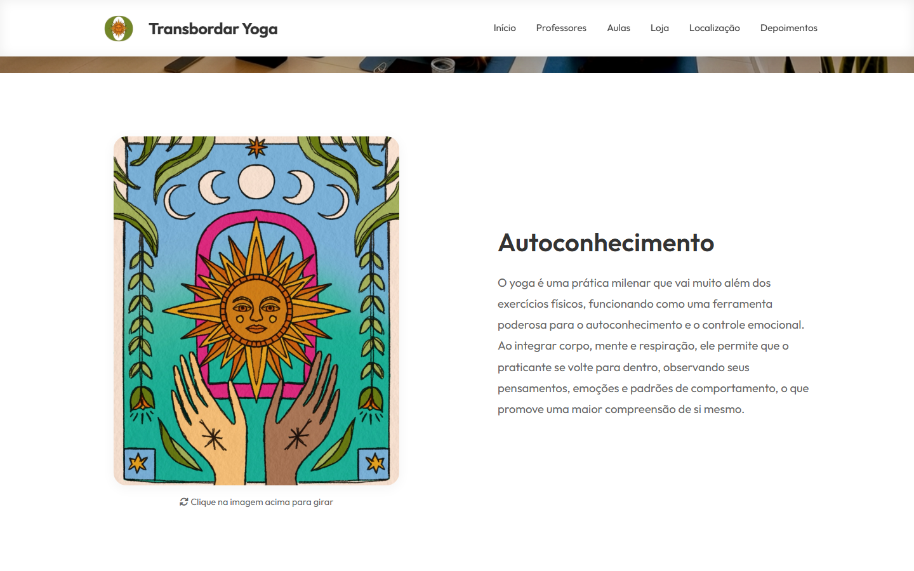
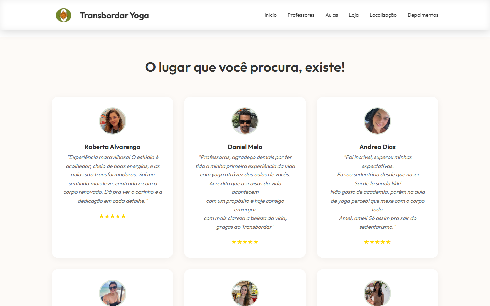
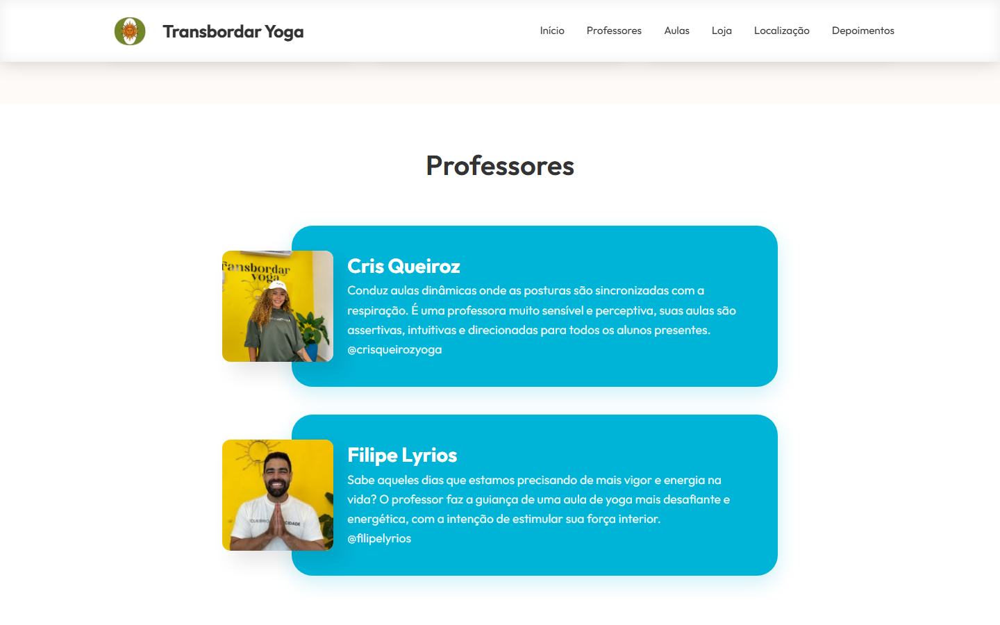
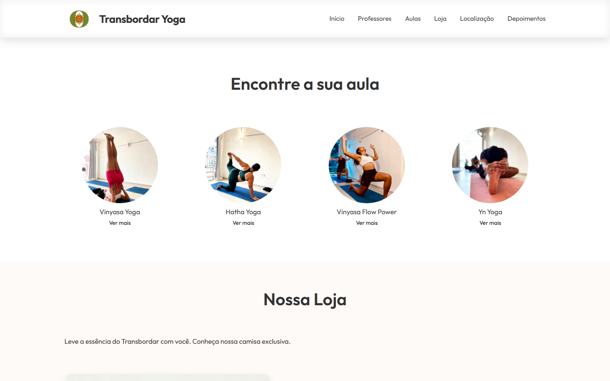
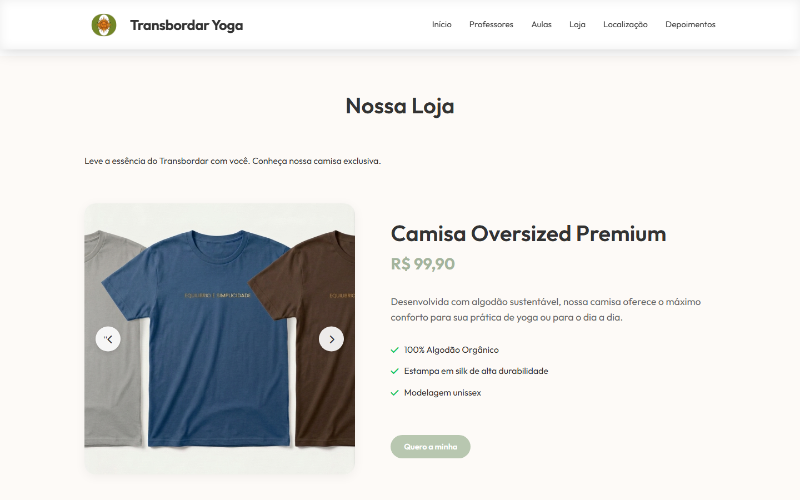
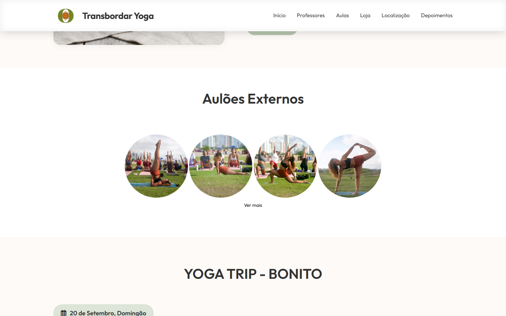
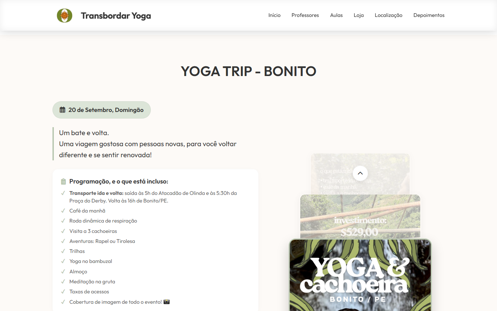
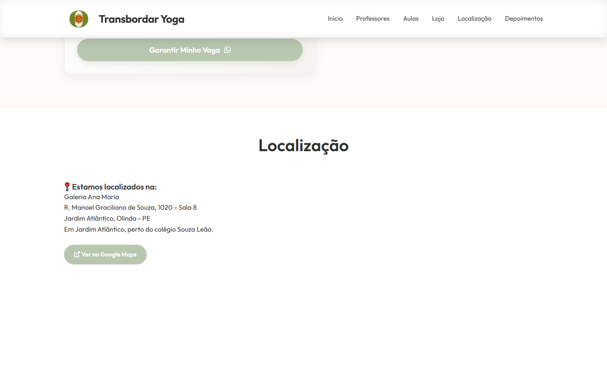

<p align="center">
  
</p>

<h1 align="center">Transbordar Yoga</h1>

<p align="center">
  Estúdio de yoga em Olinda, Pernambuco.<br>
  Equilíbrio entre corpo e mente.
</p>

<p align="center">
  <a href="https://www.transbordaryoga.com.br"><strong>www.transbordaryoga.com.br</strong></a>
  &nbsp;·&nbsp;
  <a href="https://www.instagram.com/transbordaryogaestudio">@transbordaryogaestudio</a>
  &nbsp;·&nbsp;
  <a href="mailto:yogatransbordar@gmail.com">yogatransbordar@gmail.com</a>
</p>

<p align="center">
  
</p>

---

O Transbordar é um estúdio na Galeria Ana Maria, em Jardim Atlântico, Olinda. O site apresenta o espaço, os professores, as aulas, a loja, os aulões externos e a Yoga Trip para Bonito.

A página é estática: HTML, CSS e JavaScript, sem build e sem banco de dados. As fotos abaixo foram capturadas da versão local do site.

## O site

<table>
  <tr>
    <td width="50%" valign="top">
      
      <br><strong>Autoconhecimento</strong><br>
      <sub>Carta ilustrada que gira ao clique e texto sobre a prática.</sub>
    </td>
    <td width="50%" valign="top">
      
      <br><strong>Depoimentos</strong><br>
      <sub>Relatos de quem praticou no estúdio.</sub>
    </td>
  </tr>
  <tr>
    <td width="50%" valign="top">
      
      <br><strong>Professores</strong><br>
      <sub>Cris Queiroz e Filipe Lyrios.</sub>
    </td>
    <td width="50%" valign="top">
      
      <br><strong>Aulas</strong><br>
      <sub>Vinyasa, Hatha, Vinyasa Flow Power e Yn Yoga.</sub>
    </td>
  </tr>
  <tr>
    <td width="50%" valign="top">
      
      <br><strong>Loja</strong><br>
      <sub>Camisa oversized e caneca do estúdio.</sub>
    </td>
    <td width="50%" valign="top">
      
      <br><strong>Aulões externos</strong><br>
      <sub>Práticas fora do estúdio.</sub>
    </td>
  </tr>
  <tr>
    <td width="50%" valign="top">
      
      <br><strong>Yoga Trip — Bonito</strong><br>
      <sub>Bate e volta com trilhas, cachoeiras e yoga no bambuzal.</sub>
    </td>
    <td width="50%" valign="top">
      
      <br><strong>Localização</strong><br>
      <sub>Galeria Ana Maria, Jardim Atlântico, Olinda.</sub>
    </td>
  </tr>
</table>

## Como abrir na sua máquina

Na pasta do projeto:

```powershell
python -m http.server 8080
```

Depois abra [http://127.0.0.1:8080](http://127.0.0.1:8080).

Também dá para servir com Node, na mesma pasta:

```powershell
npx --yes serve . -l 3000
```

O `index.html` abre direto no navegador. O servidor local deixa os caminhos de `assets/` e do CSS iguais aos do site publicado.

## Arquivos

| Arquivo | Função |
| --- | --- |
| `index.html` | Página única, com todas as seções |
| `index.css` | Visual: verde suave, bege e a fonte Outfit |
| `script.js` | Menu, carrossel, depoimentos em destaque e WhatsApp |
| `logo_transbordar.png` | Logo do cabeçalho |
| `assets/` | Fotos do estúdio, professores, aulas, loja e viagens |

## Onde fica o estúdio

Galeria Ana Maria  
R. Manoel Graciliano de Souza, 1020 — Sala 8  
Jardim Atlântico, Olinda — PE  

[Ver no Google Maps](https://www.google.com/maps/search/?api=1&query=-7.971541434515129,-34.8372901)

WhatsApp do estúdio: [+55 81 9 8222-8973](https://wa.me/5581982228973)

---

<p align="center">
  <sub>Desenvolvido por <a href="http://www.patrickataide.com.br">patrickataide.com.br</a></sub>
</p>
